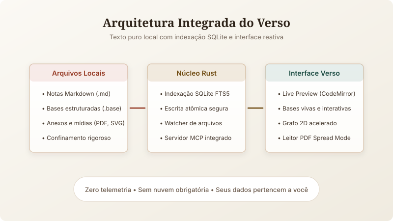

# Documentos e Mídia

O Verso é muito mais do que um leitor de texto: ele integra imagens com redimensionamento dinâmico, leitor profissional de documentos PDF e suporte a iframes interativos.

---

## 🖼️ Imagens com Controle de Escala

Você pode incluir imagens com sintaxe padrão Markdown ou com anotação de tamanho via wikilink:

### Imagem com Largura Definida (``)
Abaixo, a imagem é renderizada com 320 pixels de largura:

---

## 📑 Leitor de PDF com Spread Mode (Páginas Duplas)

O Verso inclui um visualizador completo de arquivos PDF baseado em PDF.js, com suporte a busca de texto, controle de zoom e **Spread Mode**:

- [[assets/manual-verso.pdf|Abrir o Manual do Verso (PDF)]]

### Como Usar o Modo de Páginas Duplas
Ao abrir um arquivo PDF no Verso:
1. Localize o botão com ícone de livro na barra superior de ferramentas do leitor.
2. Clique no botão para alternar entre:
   - **Página Única**: Exibição vertical contínua tradicional.
   - **Páginas Duplas (com Capa)**: A primeira página fica isolada à direita (capa), e as páginas subsequentes aparecem em pares lado a lado como em um livro físico.
   - **Páginas Duplas (sem Capa)**: Todas as páginas são exibidas em pares lado a lado desde a primeira página.

---

## 🌐 Incorporação de Páginas Web e Iframes Seguros

O Verso permite incorporar páginas da web de forma segura dentro de um sandbox isolado, tanto no modo de Leitura quanto no modo de Edição (Live Preview):

<iframe src="https://example.com" style="width: 100%; height: 320px; border-radius: 8px;"></iframe>

---

Parabéns! Você concluiu a exploração dos guias do Verso.
Retorne para a [[00 - Bem-vindo ao Verso|Página Inicial]] para revisar os tópicos ou crie suas próprias notas!
